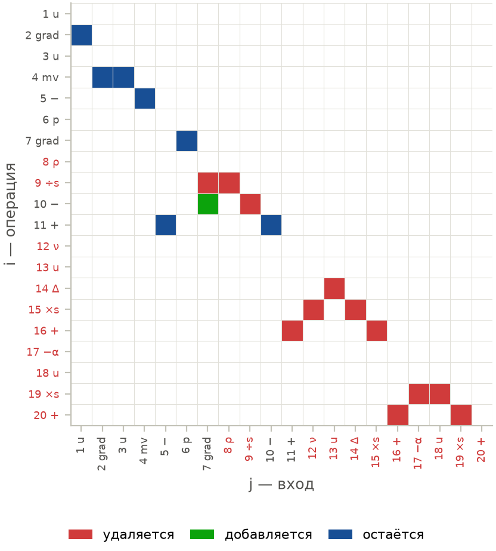

# ЛР №2: отбор элементов графа уравнения Навье–Стокса

**Карпеев Глеб · вариант 4-4-2.** Работа выполнена на модели ЛР №1
Алтая Эйнуллаева ([Chessmatus/navie-stocks-aero](https://github.com/Chessmatus/navie-stocks-aero),
коммит `13e4e8f`).

Основные материалы: [выполненный ноутбук](lab02_criteria.ipynb),
[презентация PDF](slides/lab2_presentation.pdf),
[описание эксперимента и источники](docs/experiment.md).

## Метод

Цель — определить, какие вершины и рёбра графа модели нужны для описания
данных. К дереву Навье–Стокса добавлен кандидат — линейное трение
$D=-\alpha u$. Проверяются адвекция $A$, вязкость $V$ и трение $D$.

| Пункт задания | Метод |
|---|---|
| 1.4 | Матрица Фишера вектора и подвектора параметров; для зависимых наблюдений — информация Годамбе. Сравниваются функции ошибки L2 и Хьюбера. Решения — по L2 + Годамбе; кластерный бутстрэп (п. 1.1) — только проверка ширины, не метод. |
| 2.4 | Вынос входа элемента за $k\ge3$ сигмы условного распределения, доля затронутых окон $q$. |
| 3.2 | Расстояние Кульбака–Лейблера между распределениями параметров до и после интервенции. |

Уравнение переводится в слабую форму $y=X\theta+r$: производные переносятся
на гладкие пробные функции, давление исключается соленоидальными тестами.
Элемент сохраняется, если при $k=10$, $q=1$ сдвиговая часть KL превышает
1.92 нат и знак коэффициента физически допустим. Непрошедшие элементы
удаляются по одному с повторной оценкой модели.

## Результат

| Данные | Оставить | Удалить | Итоговый граф: вершины / рёбра |
|---|---|---|---|
| Синтетика А: DNS Навье–Стокса | $A$, $V$ | $D$ | 14 / 13 |
| Синтетика Б: DNS с трением $\alpha=0.01$ | $A$, $V$, $D$ | — | 18 / 17 |
| Эксперимент: след ветротурбины, VIC#, случай 1L | $A$ | $V$, $D$ | 9 / 8 |

На обеих синтетиках восстановлена известная структура. На эксперименте
получено уравнение Эйлера с эффективным коэффициентом адвекции
$\theta_A=0.794\pm0.013$. Давление сохраняется как множитель Лагранжа,
плотность объединяется с ним в $P=p/\rho$. Удаление вязкости означает,
что её вклад не различим при данном разрешении и шуме измерений.



## Воспроизведение

Готовые ноутбук и PDF можно просматривать без запуска. Код ЛР №1 подключён
подмодулем на закреплённом коммите; авторские файлы не изменены.

Из корня клонированного репозитория:

```bash
git submodule update --init
cd lab2
python3.13 -m venv .venv
source .venv/bin/activate
python -m pip install -r requirements.txt
python -m pytest -q
ruff check .
python scripts/check_mutations.py
```

79 тестов проверяют численные методы, интервенции, критерий отбора и
изменения графа. Тестам не нужны сырые экспериментальные кадры.
`check_mutations.py` вносит во временную копию кода 14 типичных ошибок
(правило решения, интервенция, KL, Годамбе, DNS) и проверяет, что каждую
ловит хотя бы один тест.

В `results/` сохранены отчёты и компактные матрицы регрессии для построения
графиков. Полный датасет не включён. Для повторного расчёта и выполнения
всех ячеек ноутбука нужны 86 кадров VIC# (около 3.6 ГБ после загрузки):

```bash
python scripts/fetch_data.py
python scripts/run_experiments.py
python scripts/build_notebook.py
python scripts/run_notebook.py
python scripts/build_slides.py  # дополнительно требуется Tectonic
```

Загрузчик использует HTTP byte ranges и проверяет CRC32 и SHA-256.
Источник — [DataverseNO, DOI 10.18710/SX0ZQT](https://doi.org/10.18710/SX0ZQT),
CC0; происхождение кадров записано в [манифесте](data/turbine_1L_manifest.json).

`lab02/` содержит реализацию, `tests/` — проверки, `scripts/` — команды
воспроизведения. Рисунки презентации находятся в `figures/`, её исходник —
[slides/lab2_presentation.tex](slides/lab2_presentation.tex).
Использование ИИ описано в [AI_USAGE.md](AI_USAGE.md).
